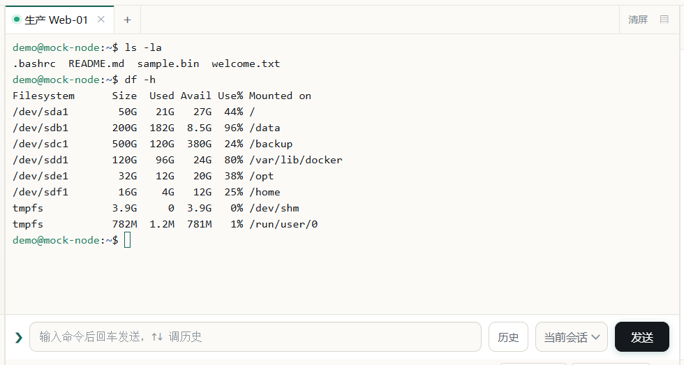
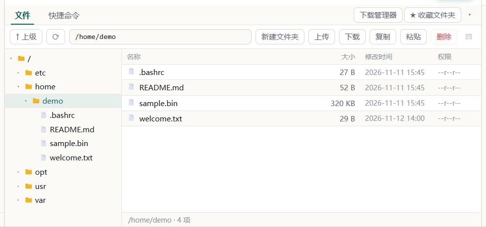
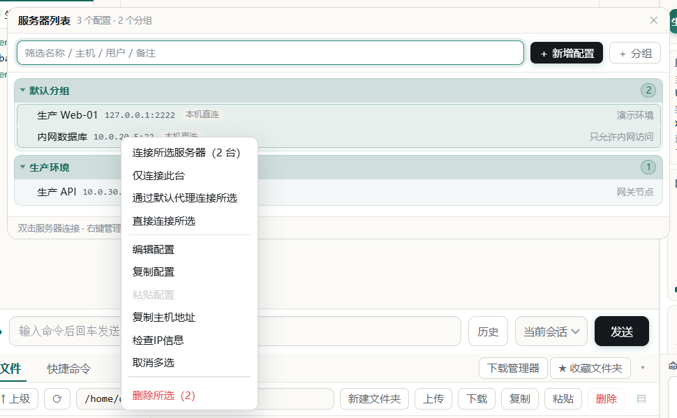
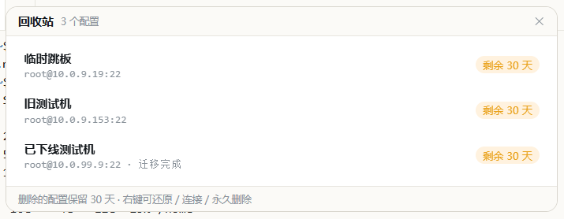
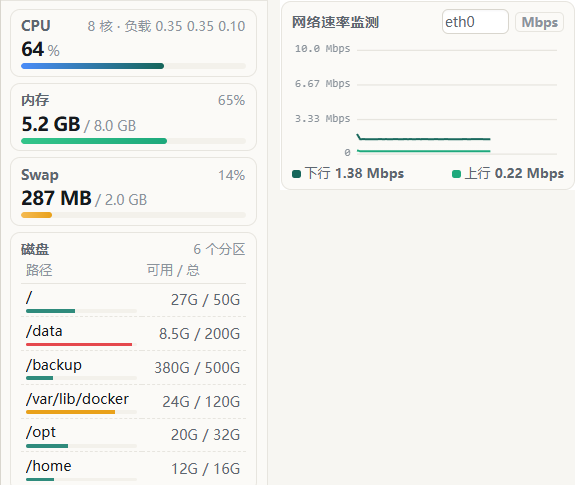
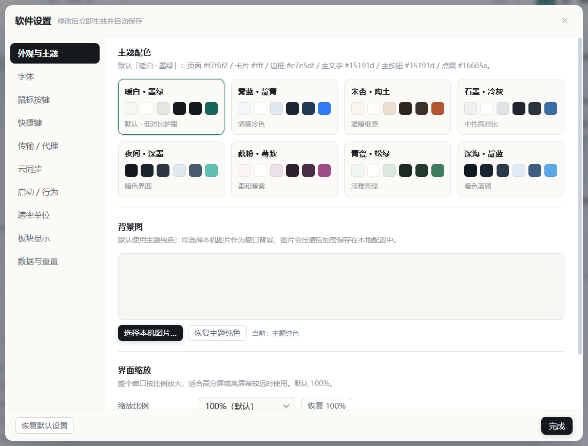

<div align="center">

<br>

<br>

<h2>源码公开、易用、免费、跨平台 的 SSH 终端</h2>

[官网](https://shell.minecft.cn)　·　[GitHub 仓库](https://github.com/LIULIWANJIA/Liulishell)　·　[Gitee 仓库](https://gitee.com/liuliwanjiaweb/liuli-shell)

[GitHub Releases](https://github.com/LIULIWANJIA/Liulishell/releases)　·　[Gitee Releases](https://gitee.com/liuliwanjiaweb/liuli-shell/releases)

当前版本：**v1.14.8** | Windows 10/11 · Linux GUI · macOS

**使用限制：** 仅限个人、非营利、教育与研究等非商业用途；任何商业主体或商业场景禁止使用；衍生版本须在用户可见的明显区域署名原作者。详见 [LICENSE](LICENSE)。

</div>

---

## 下载

### Windows 10 / 11 x64

| 版本 | 说明 | 下载 |
| --- | --- | --- |
| **便携版（推荐）** | 免安装，双击即用 | [GitHub](https://github.com/LIULIWANJIA/Liulishell/releases) · [Gitee](https://gitee.com/liuliwanjiaweb/liuli-shell/releases) · [夸克网盘](https://pan.quark.cn/s/3b9930496416?pwd=YKXY)（提取码 `YKXY`） |
| **安装版** | 有安装向导，自动创建桌面快捷方式 | [GitHub](https://github.com/LIULIWANJIA/Liulishell/releases) · [Gitee](https://gitee.com/liuliwanjiaweb/liuli-shell/releases) · [夸克网盘](https://pan.quark.cn/s/3b9930496416?pwd=YKXY)（提取码 `YKXY`） |

> 便携版和安装版配置默认都在 `%APPDATA%\LIULI Shell`；便携版 exe 同目录存在 `data` 文件夹时，会改用该目录作为配置目录。升级、重装或卸载不会删除数据。

### Linux GUI / macOS 快速构建

> 需要 Git（macOS 另需 Node.js ≥ 18，推荐 20 LTS；Linux 脚本会自动补齐 Node 与系统依赖），并在对应系统上构建，产物互不通用。Gitee 克隆可能提示输入账号与密码，完成后再执行下一条。

### Linux GUI 快速构建

> 需要 Git；没有时按发行版选一条安装：

Debian / Ubuntu：

```bash
sudo apt-get update && sudo apt-get install -y git
```

Fedora / RHEL：

```bash
sudo dnf install -y git
```

Arch：

```bash
sudo pacman -S --needed git
```

**1. 克隆源码（Gitee，国内推荐）**

```bash
rm -rf liuli-shell Liulishell && git clone https://gitee.com/liuliwanjiaweb/liuli-shell.git
```

**GitHub 源（与上面二选一）**

```bash
rm -rf liuli-shell Liulishell && git clone https://github.com/LIULIWANJIA/Liulishell.git liuli-shell
```

**2. 进入目录并一键构建**

```bash
cd liuli-shell && bash scripts/build-linux.sh
```

脚本自动识别发行版、补齐系统依赖，可选 `deb` / `AppImage`，打包完成后询问是否安装。产物在 `dist/`。

只打 `.tar.gz`：

```bash
bash scripts/build-linux.sh tar
```

环境异常时先体检：

```bash
bash scripts/build-linux.sh check
```

**仅当依赖异常或构建报错时，按顺序逐条执行：**

```bash
bash scripts/build-linux.sh repair
```

```bash
bash scripts/build-linux.sh deps
```

```bash
bash scripts/build-linux.sh
```

### MAC OS 快速构建

> 需要 macOS 12+（Intel 或 Apple Silicon）与 Git，dmg 不能在 Windows / Linux 上构建。以下命令请逐条执行。

**1. 安装基础环境（已装过自动跳过；`xcode-select` 会弹窗，等安装完成再继续）**

```bash
xcode-select --install 2>/dev/null || true
```

```bash
command -v brew >/dev/null || /bin/bash -c "$(curl -fsSL https://raw.githubusercontent.com/Homebrew/install/HEAD/install.sh)"
```

> 安装 Homebrew 时会要求输入当前用户密码。新装后需把 brew 加入当前终端 PATH：

```bash
if [ -x /opt/homebrew/bin/brew ]; then eval "$(/opt/homebrew/bin/brew shellenv)"; elif [ -x /usr/local/bin/brew ]; then eval "$(/usr/local/bin/brew shellenv)"; fi
```

```bash
node -v 2>/dev/null | grep -qE '^v(1[89]|[2-9][0-9])' || brew install node@20
```

```bash
brew link --overwrite --force node@20 >/dev/null 2>&1 || true
```

```bash
node -v && npm -v
```

**2. 克隆源码（Gitee / GitHub 二选一）**

先清理旧目录：

```bash
rm -rf liuli-shell Liulishell
```

Gitee（国内推荐）：

```bash
git clone https://gitee.com/liuliwanjiaweb/liuli-shell.git liuli-shell
```

GitHub（海外推荐）：

```bash
git clone https://github.com/LIULIWANJIA/Liulishell.git liuli-shell
```

**3. 安装依赖并构建**

```bash
cd liuli-shell
```

```bash
npm ci || npm install
```

```bash
npm run vendor
```

国内网络下载 Electron 较慢时（可选）：

```bash
export ELECTRON_MIRROR=https://registry.npmmirror.com/-/binary/electron/
```

```bash
export ELECTRON_BUILDER_BINARIES_MIRROR=https://registry.npmmirror.com/-/binary/electron-builder-binaries/
```

```bash
npm run dist:mac
```

只打 Apple Silicon（可选）：

```bash
npx electron-builder --mac dmg zip --arm64
```

产物在 `dist/`（`.dmg` / `.zip`，默认 x64 + arm64）。`npm run vendor` 会把 xterm 资源复制到 `src/renderer/vendor`，打包前必须执行；Intel 与 Apple Silicon 产物互不通用。未签名的 App 若被 Gatekeeper 拦截，右键「打开」放行即可。

---

## 交流与反馈

| 渠道 | 链接 |
| --- | --- |
| QQ 群（国内） | `1127112572` · [点击加群](https://qm.qq.com/q/30jvArYWDm) |
| Telegram（海外） | [t.me/liulishell](https://t.me/liulishell) |

问题反馈、功能建议与版本动态会在群内同步维护。

---

## 功能概览

- **多标签 SSH 终端**：状态灯、断开重连、标签拖动排序、命令历史与补全
- **SFTP 文件管理**：目录树 + 文件列表 + 内置编辑器，终端 `cd` 跟随；拖拽上传、整目录下载、权限管理、打包传输
- **FinalShell 迁移**：支持直接导入 FinalShell 导出的 JSON 备份，也支持文件夹拖放导入
- **服务器管理**：分组与多选、拖动移动到其他分组、配置复制粘贴、30 天回收站、检查 IP 信息
- **实时监控**：CPU、内存、Swap、磁盘、网卡速率与进程预览，量程自适应
- **WebDAV 加密同步**：配置、分组、收藏文件夹与回收站双向合并，多设备迁移不丢改动
- **个性化**：8 套主题（含暗色）、界面缩放、快捷命令板块

### 界面预览

| 多标签 SSH 终端 | SFTP 文件管理 |
| :---: | :---: |
|  |  |

| 服务器管理与多选 | 配置回收站 |
| :---: | :---: |
|  |  |

| 实时监控 | 主题与界面 |
| :---: | :---: |
|  |  |

---

## 许可证

本项目采用 **[LIULI Shell 非商业署名许可证](LICENSE)**。源码公开，但**不属于 OSI 定义的开源许可证**（因包含非商业限制）。

- **允许**：个人、非营利、教育、研究等非商业用途下，自由使用、复制、研究、修改源码，并以源码或二进制形式发布衍生版本。
- **要求**：分发本软件或衍生版本时，必须在「关于」界面、启动页、主界面或文档首屏等**用户可见的明显区域**署名原作者 `LIULIWANJIA`、注明原项目地址、说明修改情况，并附本许可证全文或链接；仅在源码注释或深层目录的 LICENSE 文件里出现不算数。
- **禁止**：任何商业主体、任何商业场景使用（包括企业内部免费自用、生产环境部署、集成到付费产品、收费的技术支持与培训）；商业使用须事先取得原作者**书面授权**。
- **衍生版本**：须沿用同等约束条款，不得通过换许可证或加条款规避署名与非商业限制。
- **第三方组件**：Electron、xterm.js、ssh2 等依赖仍适用各自原始许可证，不受本许可证影响。

完整条款以仓库根目录的 [LICENSE](LICENSE) 为准；商业授权请通过项目主页联系原作者。

---

<div align="center">

**LIULIWANJIA 官方正版 Liulishell** · [官网](https://shell.minecft.cn) · [GitHub](https://github.com/LIULIWANJIA/Liulishell) · [Gitee](https://gitee.com/liuliwanjiaweb/liuli-shell)

</div>
