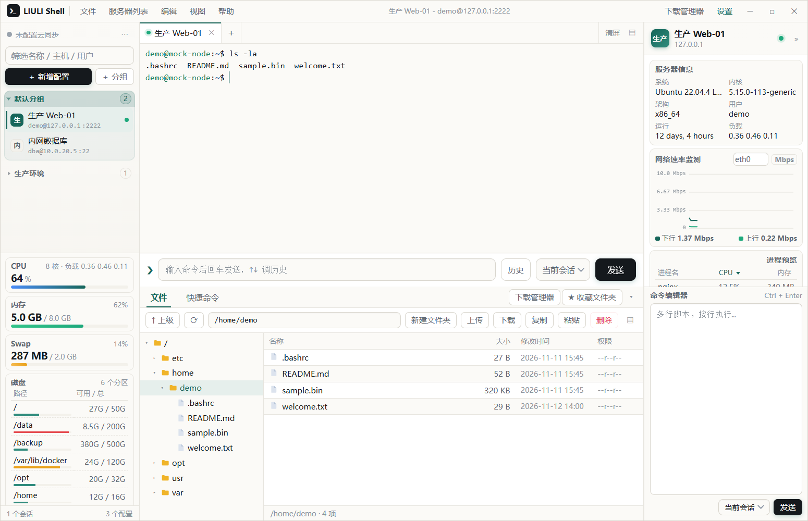

# LIULI Shell

<h2>源码公开、易用、免费、跨平台 的 SSH 终端</h2>

[官网](https://shell.minecft.cn)　·　[GitHub 仓库](https://github.com/LIULIWANJIA/Liulishell)　·　[Gitee 仓库](https://gitee.com/liuliwanjiaweb/liuli-shell)

[GitHub Releases](https://github.com/LIULIWANJIA/Liulishell/releases)　·　[Gitee Releases](https://gitee.com/liuliwanjiaweb/liuli-shell/releases)

当前版本：**v1.14.4** | Windows 10/11 · Linux GUI · macOS

**使用限制：** 仅限个人、非营利、教育与研究等非商业用途；任何商业主体或商业场景禁止使用；衍生版本须在用户可见的明显区域署名原作者。详见 [LICENSE](LICENSE)。

---

## 下载

### Windows 10 / 11 x64

| 版本 | 说明 | 下载 |
| --- | --- | --- |
| **便携版（推荐）** | 约 93 MB，免安装，双击即用 | [GitHub Releases](https://github.com/LIULIWANJIA/Liulishell/releases) · [Gitee Releases](https://gitee.com/liuliwanjiaweb/liuli-shell/releases) · [夸克网盘](https://pan.quark.cn/s/3b9930496416?pwd=YKXY)（提取码 `YKXY`） |
| **安装版** | NSIS 安装向导，创建开始菜单与桌面快捷方式 | [GitHub Releases](https://github.com/LIULIWANJIA/Liulishell/releases) · [Gitee Releases](https://gitee.com/liuliwanjiaweb/liuli-shell/releases) · [夸克网盘](https://pan.quark.cn/s/3b9930496416?pwd=YKXY)（提取码 `YKXY`） |

> 便携版配置写在 exe 同级的 `data` 目录；安装版配置在 `%APPDATA%\LIULI Shell`。升级、重装或卸载不会删除数据。

### Linux GUI / macOS 快速构建

> 需要 Node.js ≥ 18（推荐 20 LTS）与 Git，并在对应系统上构建，产物互不通用。Gitee 克隆可能提示输入账号与密码，完成后再执行下一条。

<table>
<tr>
<td valign="top" width="50%">

<b>Linux GUI</b>

<pre><code>rm -rf liuli-shell Liulishell &amp;&amp; git clone https://gitee.com/liuliwanjiaweb/liuli-shell.git
cd liuli-shell &amp;&amp; bash scripts/build-linux.sh</code></pre>

脚本自动识别发行版、补齐系统依赖，可选 <code>deb</code> / <code>AppImage</code>，打包完成后询问是否安装。产物在 <code>dist/</code>，也支持 <code>.tar.gz</code>。

</td>
<td valign="top" width="50%">

<b>MAC OS</b>

<pre><code>xcode-select --install
brew install node@20
rm -rf liuli-shell Liulishell &amp;&amp; git clone https://gitee.com/liuliwanjiaweb/liuli-shell.git
cd liuli-shell
npm ci
npm run vendor &amp;&amp; npm run dist:mac</code></pre>

产出 <code>.dmg</code> / <code>.zip</code>（x64 + arm64）。未签名的 App 若被 Gatekeeper 拦截，右键「打开」放行即可。

</td>
</tr>
</table>

> **GitHub 源**：把上面的克隆地址替换为 `https://github.com/LIULIWANJIA/Liulishell.git liuli-shell` 即可。Linux 依赖异常时再执行 `bash scripts/build-linux.sh repair` 和 `bash scripts/build-linux.sh deps`。

---

## 交流与反馈

| 渠道 | 链接 |
| --- | --- |
| QQ 群（国内） | `1127112572` · [点击加群](https://qm.qq.com/q/30jvArYWDm) |
| Telegram（海外） | [t.me/liulishell](https://t.me/liulishell) |

问题反馈、功能建议与版本动态会在群内同步维护。

---

## 功能概览

- **多标签 SSH 终端**：状态灯、断开重连、标签拖动排序、命令历史与补全
- **SFTP 文件管理**：目录树 + 文件列表 + 内置编辑器，终端 `cd` 跟随；拖拽上传、整目录下载、权限管理、打包传输
- **服务器管理**：分组与多选、拖动移动到其他分组、配置复制粘贴、30 天回收站、检查 IP 信息
- **实时监控**：CPU、内存、Swap、磁盘、网卡速率与进程预览，量程自适应
- **WebDAV 加密同步**：配置、分组、收藏文件夹与回收站双向合并，多设备迁移不丢改动
- **个性化**：8 套主题（含暗色）、界面缩放、快捷命令板块、FinalShell 配置导入

---

## 许可证

本项目采用 **[LIULI Shell 非商业署名许可证](LICENSE)**。源码公开，但**不属于 OSI 定义的开源许可证**（因包含非商业限制）。

- **允许**：个人、非营利、教育、研究等非商业用途下，自由使用、复制、研究、修改源码，并以源码或二进制形式发布衍生版本。
- **要求**：分发本软件或衍生版本时，必须在「关于」界面、启动页、主界面或文档首屏等**用户可见的明显区域**署名原作者 `LIULIWANJIA`、注明原项目地址、说明修改情况，并附本许可证全文或链接；仅在源码注释或深层目录的 LICENSE 文件里出现不算数。
- **禁止**：任何商业主体、任何商业场景使用（包括企业内部免费自用、生产环境部署、集成到付费产品、收费的技术支持与培训）；商业使用须事先取得原作者**书面授权**。
- **衍生版本**：须沿用同等约束条款，不得通过换许可证或加条款规避署名与非商业限制。
- **第三方组件**：Electron、xterm.js、ssh2 等依赖仍适用各自原始许可证，不受本许可证影响。

完整条款以仓库根目录的 [LICENSE](LICENSE) 为准；商业授权请通过项目主页联系原作者。

---

**LIULIWANJIA 官方正版 Liulishell** · [官网](https://shell.minecft.cn) · [GitHub](https://github.com/LIULIWANJIA/Liulishell) · [Gitee](https://gitee.com/liuliwanjiaweb/liuli-shell)

