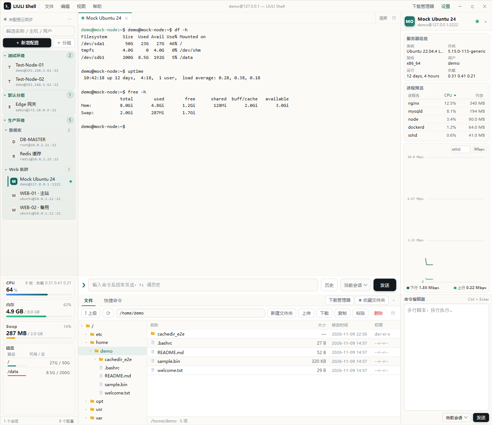

# LIULI Shell

> **更易用的跨平台 SHELL 终端** · 作者 **LIULIWANJIA** · by LIULIWANJIA
> 官网：<https://shell.minecft.cn>　|　源码：<https://gitee.com/liuliwanjiaweb/liuli-shell>　|　当前版本 **v1.14.1**

LIULI Shell 是一款跨平台 SSH 终端与服务器管理工具（Windows / Linux / macOS），界面参考 FinalShell，把日常运维需要的东西放进同一个三栏窗口：

- **多标签终端**：每个标签独立 SSH 会话，状态灯、右键重连、拖动排序、命令历史与补全
- **快速文件管理器**：SFTP 目录树 + 文件列表 + 独立文本编辑器，终端 `cd` 自动跟随，支持拖拽上传与整目录下载
- **实时状态监控**：CPU、内存、Swap、磁盘、网卡速率与进程预览，量程自适应
- **WebDAV 加密云同步**：配置、分组、收藏双向合并，加密上传，多设备不丢改动
- **FinalShell 配置导入**、下载管理器、8 套主题（含 2 套暗色）、界面缩放、快捷命令板块

技术栈：Electron + xterm.js + ssh2（原生 SFTP 与 shell channel，无外部命令依赖）。



更多界面：[隐藏信息栏布局](docs/assets/layout-current.png) · [设置中心](docs/assets/settings-current.png) · [快捷命令](docs/assets/snippets-current.png)

---

## 一、软件下载与安装

### Windows 10 / 11 x64（现成安装包）

优先推荐**便携版**：免安装、双击即用，配置写在 exe 同级的 `data` 目录，适合放 U 盘或临时环境。

| 版本 | 下载地址 | 说明 |
| --- | --- | --- |
| **便携版（推荐）** | [Gitee Releases](https://gitee.com/liuliwanjiaweb/liuli-shell/releases) | `LIULI Shell 1.14.1 Portable.exe` · 约 93 MB · 免安装 |
| **安装版** | [夸克网盘](https://pan.quark.cn/s/3b9930496416?pwd=YKXY)（提取码 `YKXY`） | `LIULI Shell Setup 1.14.1.exe` · 约 102 MB · NSIS 安装向导 |

**安装与升级：**

- 全新安装默认目录 `D:\LIULISHELL`（无 D 盘时为 `C:\Program Files\LIULISHELL`），向导中可自行修改，完成后自动创建桌面图标。
- **自选目录会自动补上 `LIULISHELL` 子文件夹**：例如选择 `D:\Win64EXE`，实际安装到 `D:\Win64EXE\LIULISHELL`，避免把程序直接装进其他软件所在的通用目录；若所选目录本身已以 `LIULISHELL` 结尾则不会再重复追加。升级 / 覆盖安装沿用原目录，不做追加。
- 安装器读取注册表 `DisplayVersion`：检测到低版本 → 按钮变「升级」并沿用原目录；同版本询问是否覆盖；`/S` 静默安装不弹窗。升级前请先退出正在运行的实例。
- **升级 / 重装 / 卸载都不会删除数据**：配置在 `%APPDATA%\LIULI Shell`（`liulishell-data.json` + 加密凭据），安装器只清理安装目录。
- 便携版默认与安装版共用上述配置目录；若要完全随身携带，在便携版 exe 同级新建 `data` 文件夹即可。**便携版 exe 不要放进安装目录**（升级时会被整体替换）。
- 换机 / 重装系统时用「设置 → 云同步」或「手动备份 / 恢复」迁移配置。

### Linux / macOS

源码构建，见下一节。Linux 产出 `.deb` / AppImage / `.tar.gz`，macOS 产出 `.dmg` / `.zip`。

---

## 二、源码构建教程

> 要求 Node.js ≥ 18（推荐 20 LTS）、Git。Linux 与 macOS 必须在对应系统（或同架构 CI）上构建，产物互不通用。
> **请一条一条执行**，不要整段粘贴：Gitee 拉取源码时会提示输入账户与密码，等克隆完成、回到命令行提示符后再执行下一条。

### Linux 快速构建（推荐）

```bash
# 1) 先删掉旧目录再克隆，避免上次残留的文件让构建异常
rm -rf liuli-shell && git clone https://gitee.com/liuliwanjiaweb/liuli-shell.git

# 2) 一条命令：进入项目目录 识别发行版 → 补系统依赖 → 选 deb / AppImage → 打包 → 询问安装
cd liuli-shell && bash scripts/build-linux.sh
```

脚本按顺序完成：识别发行版与版本 → 检测并补齐系统依赖 → 选择包类型 → 打包 → 询问是否安装。
向导会提示选择 `1 = deb` / `2 = AppImage` / `3 = 两者都要`（直接回车默认 deb），打包完成后询问是否安装并创建桌面图标；自动适配 Ubuntu 24.04+ 的 `*t64` 包名回退，支持 apt / dnf / yum / pacman / zypper。

**仅在依赖没装上或构建报错时**，再按顺序逐条尝试下面三条（正常构建无需执行）：

```bash
# 3) 依赖没装上或构建报错时，再依次尝试
bash scripts/build-linux.sh repair
bash scripts/build-linux.sh deps
bash scripts/build-linux.sh
```

| 命令 | 作用 |
| --- | --- |
| `bash scripts/build-linux.sh` | 交互式打包，完成后询问是否安装 |
| `bash scripts/build-linux.sh deb` / `appimage` / `both` / `tar` | 直接指定产物，不再询问 |
| `bash scripts/build-linux.sh deps` | 只安装 / 补全系统依赖 |
| `bash scripts/build-linux.sh check` | 只体检：打印系统信息与缺失依赖，不改动系统 |
| `bash scripts/build-linux.sh repair` | 修复构建环境（dpkg 中断、破损依赖、npm 源、Electron 二进制） |
| 附加开关 `-y` / `--no-install` / `--no-deps` | 免询问安装 / 只打包不安装 / 跳过依赖安装 |

### macOS 快速构建

```bash
# 基础环境（已装过会自动跳过）
xcode-select --install 2>/dev/null || true
command -v brew >/dev/null || /bin/bash -c "$(curl -fsSL https://raw.githubusercontent.com/Homebrew/install/HEAD/install.sh)"
command -v node >/dev/null || brew install node@20
brew link --overwrite --force node@20 >/dev/null 2>&1 || true

# 先删旧目录再克隆
rm -rf liuli-shell
git clone https://gitee.com/liuliwanjiaweb/liuli-shell.git
cd liuli-shell
npm ci || npm install      # 失败自动回退 npm install
npm run vendor
npm run dist:mac                              # x64 + arm64 一起出
npx electron-builder --mac dmg zip --arm64    # 只打 Apple Silicon
```

`npm run vendor` 会复制 xterm 资源到 `src/renderer/vendor`，打包前必须执行。未签名被 Gatekeeper 拦截时可右键「打开」放行，或执行：

```bash
xattr -dr com.apple.quarantine "/Applications/LIULI Shell.app"
```

对外分发需 Developer ID 证书并 notarize：配置 `CSC_LINK`、`CSC_KEY_PASSWORD`、`APPLE_ID`、`APPLE_APP_SPECIFIC_PASSWORD`、`APPLE_TEAM_ID`。

### 构建常见报错

| 报错 / 现象 | 处理 |
| --- | --- |
| 无法定位软件包 `libasound2` | 24.04+ 已改名 `*t64`，跑 `bash scripts/build-linux.sh deps` 自动回退 |
| `dlopen(): error loading libfuse.so.2` | 装 `libfuse2` / `libfuse2t64`，或加 `--appimage-extract-and-run`，或改用 tar.gz |
| Electron 下载超时 | `export ELECTRON_MIRROR=https://registry.npmmirror.com/-/binary/electron/` |
| `npm ci` 失败 | 删除 `node_modules` 后改 `npm install`；确认 Node ≥ 18 |
| `rpmbuild not found` | 只有打 rpm 才需要，装 `rpm-build` 后再试 |

### 产物与 npm 脚本

产物统一输出到项目根目录 `dist/`。安装包体积较大，**不要提交进仓库**，请上传到 Gitee Releases 或网盘。

```bash
npm install              # 安装依赖
npm start                # 开发模式启动
npm run mock             # 本地模拟 SSH 服务器：127.0.0.1:2222，用户 demo，密码任意

npm run dist:win              # Windows x64：NSIS 安装包 + 便携版
npm run dist:win:installer    # 仅 NSIS 安装包
npm run dist:win:portable     # 仅便携版
npm run dist:linux            # Linux x64：AppImage + deb + tar.gz
npm run dist:linux:appimage   # 仅 AppImage
npm run dist:linux:deb        # 仅 deb
npm run dist:linux:tar        # 仅 tar.gz（不依赖 FUSE，兼容性最好）
npm run dist:mac              # macOS：dmg + zip（x64 / arm64，需在 macOS 上构建）
```

> AppImage 的运行下限由**构建机的 glibc** 决定，想让 Ubuntu 20.04 ~ 26.04 通用，请在 20.04 上构建。
> 国内网络可加：`ELECTRON_MIRROR=https://registry.npmmirror.com/-/binary/electron/ ELECTRON_BUILDER_BINARIES_MIRROR=https://registry.npmmirror.com/-/binary/electron-builder-binaries/`

---

## 三、项目说明

- 官网单页静态站单独维护，`website/` 不纳入本仓库；下载走外链，仓库不再存放安装包。
- 界面布局、设置项、功能清单、云同步合并策略、数据安全与已知限制等**详细设计文档**见 [项目设计.md](项目设计.md)。
- 配置位置：Windows `%APPDATA%\LIULI Shell`，Linux `~/.config/LIULI Shell/`。密码、私钥、口令用 `safeStorage` 加密落盘，渲染进程拿不到明文。
- 数据文件写入前自动备份；损坏时自动改名留档并从 `.bak` 恢复。

---

版本 **v1.14.1** · 作者 **LIULIWANJIA** · 跨平台 SHELL 工具 · 人性化的 · 更易用的
